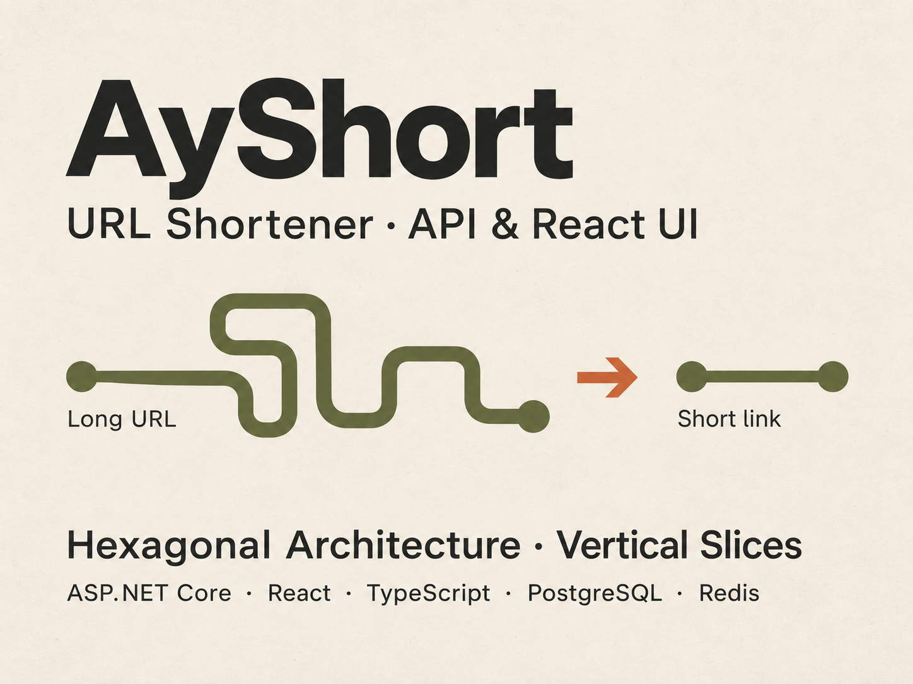
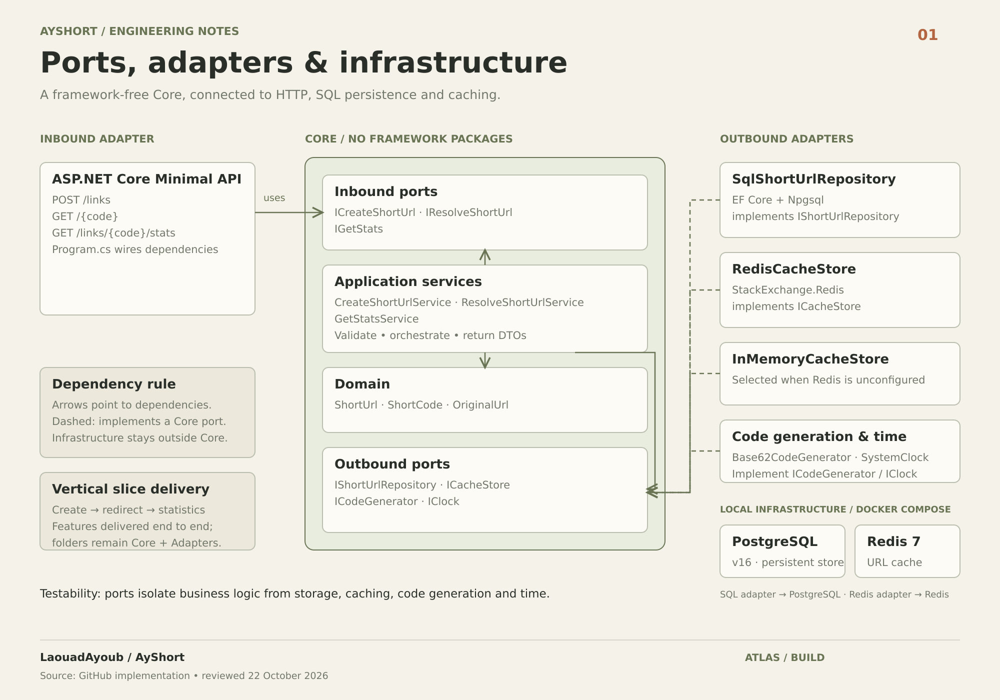

# AyShort — .NET API & React interface

Create a short link, share it, and follow it to the original destination. AyShort combines an ASP.NET Core API with a React/TypeScript interface, backed by PostgreSQL.

**[Try the live app](https://app.ayshort.cc/)** · **[Explore the API](https://ayshort.cc/swagger)** · **[Technical guide](docs/technical-guide.md)**



## What you can do

Open the [live app](https://app.ayshort.cc/), enter an HTTP or HTTPS URL, and select **Shorten**. The interface displays a usable link such as `https://ayshort.cc/abc1234`, with loading feedback and messages for invalid input or failed requests.

| Capability | Web interface | API |
| --- | --- | --- |
| Create a short link | Available | `POST /links` |
| Follow a short link | Open the returned link | `GET /{code}` returns HTTP 302 |
| Choose a custom alias or expiration | Not yet exposed in the form | Optional fields on `POST /links` |
| Read access statistics | No statistics screen yet | `GET /links/{code}/stats` |
| Copy with a dedicated button | Planned; manual copying works | Not applicable |

Statistics include recorded accesses, creation time, last access and expiration. Access counts are not unique visitors: repeated requests and automated scanners can contribute.

## Engineering approach

This project brings a backend through design, implementation, testing and public deployment, then connects it to a usable interface. The emphasis is on understandable boundaries and features that can be reviewed end to end.

### Hexagonal architecture

The **Core** contains domain rules, application services and ports, without ASP.NET Core, EF Core or Redis package references. Adapters connect those ports to HTTP, PostgreSQL, caching, code generation and time.

- **HTTP stays at the edge:** Minimal API endpoints translate requests into use-case calls and map results to HTTP responses.
- **Infrastructure implements Core contracts:** SQL and cache adapters can change without putting their frameworks in the business logic.
- **Use cases are testable:** repository, cache, code-generator and clock ports allow focused tests of validation and behavior.



*Backend architecture and local infrastructure. The diagram shows PostgreSQL and optional Redis for development; the hosted demo uses in-memory caching. React and cloud hosting are shown separately below.*

### Vertical-slice delivery

Features were delivered one behavior at a time: **create a link → redirect → retrieve statistics**, followed by browser integration and deployment. Each change connects the layers it needs. The repository remains organized into `Core` and `Adapters`; “vertical slices” describes the delivery approach, not a separate feature-folder layout.

The React interface uses a controlled form and local state. A named API helper handles `fetch`, HTTP failures and response-shape checks. Tailwind styling follows the cream, charcoal and olive visual direction of the project cover.

## Public deployment

```text
Create a link:
Browser → app.ayshort.cc (Vercel / React)
        → /api/links rewrite → Render / ASP.NET Core → Neon / PostgreSQL

Follow a link:
Browser → ayshort.cc/{code} (Render) → original destination
```

| Component | Implementation | Hosted service |
| --- | --- | --- |
| Interface | React, TypeScript, Vite and Tailwind CSS | Vercel |
| API | ASP.NET Core Minimal API, packaged in Docker | Render |
| Persistence | PostgreSQL with Entity Framework Core / Npgsql | Neon |
| Cache | Redis adapter or in-memory implementation | In-memory in the public demo; no hosted Redis |

The database preserves links across API redeploys; the in-memory cache can be rebuilt. `Shortener__BaseUrl` controls the origin used in generated links, while DNS connects the custom domains to their hosts. See the [deployment guide](docs/deployment.md) for configuration and health checks.

## Verification and current limits

- **Backend:** unit tests cover use cases; integration tests exercise HTTP behavior and persistence against a dedicated PostgreSQL database.
- **Frontend:** API-helper tests simulate successful responses, validation errors, network failures and invalid response bodies. ESLint and the production build check the frontend locally.
- **Browser checks:** real creation and redirects, loading/disabled controls, validation and retry, keyboard interaction and narrow layouts were checked during delivery.
- **CI:** [GitHub Actions](https://github.com/LaouadAyoub/AyShort/actions/workflows/ci.yml) builds and tests the backend on pull requests. Frontend test/lint commands are not currently part of that workflow. Its push filter still names `main`, although the default branch is `master`.

This is a working portfolio demo, not a measured availability guarantee. Open work includes [redirect independence from click recording (#25)](https://github.com/LaouadAyoub/AyShort/issues/25), [concurrent click-count accuracy (#26)](https://github.com/LaouadAyoub/AyShort/issues/26), [runtime and deployment maintenance (#27)](https://github.com/LaouadAyoub/AyShort/issues/27), and [remaining observability/resilience work (#18)](https://github.com/LaouadAyoub/AyShort/issues/18). Cached-link expiration behavior also needs further coverage; expiration checks must not be assumed complete on every path.

## Run locally

Prerequisites: **.NET 10 SDK**, **Node.js 22.14+** and **Docker Compose**.

From the repository root, start the local database and Redis, then the API:

```powershell
docker compose up -d postgres redis
$env:ConnectionStrings__Default = "Host=127.0.0.1;Port=5434;Database=ays;User Id=ays;Password=ays"
$env:Shortener__BaseUrl = "http://localhost:5142"
dotnet run --project src/Adapters/In/WebApi/WebApi.csproj --launch-profile http
```

These credentials are for the local Docker development database only. The API applies EF Core migrations at startup. Its [local Swagger UI](http://localhost:5142/swagger) lists the endpoints.

In a second terminal, from the repository root:

```powershell
cd frontend
npm ci
npm run dev
```

Open the address printed by Vite. Its development proxy forwards `/api/links` to `http://localhost:5142/links`. Keep both servers running.

For automated test commands, database isolation, Redis configuration and API examples, use the [technical guide](docs/technical-guide.md).

## Explore the documentation

- [Technical guide](docs/technical-guide.md) — detailed create/resolve/stats flows, API examples, configuration, migrations and tests; preserves the original README material.
- [Architecture notes](docs/02-architecture.md) — backend boundaries, ports and trade-offs, with historical design targets distinguished from delivered behavior.
- [Product brief](docs/01-product-brief.md) — original goals and requirements.
- [Roadmap](docs/03-roadmap.md) — original slice plan; use linked GitHub issues for current delivery status.
- [Deployment](docs/deployment.md) — Docker, Vercel, Render, Neon and custom-domain configuration.
- [Frontend guide](frontend/README.md) — frontend commands and development proxy.
- [Redis testing](docs/04-testing-redis.md) and [monitoring](docs/REDIS-MONITORING.md) — local cache inspection.
