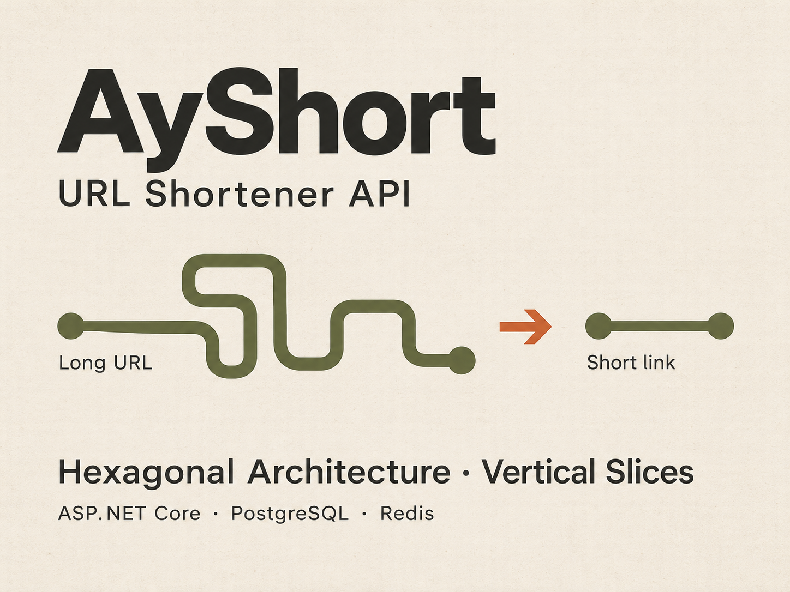

# AyShort frontend — design brief

This file lives at frontend/frontend-design.md, relative to the repository root.
Version 1.1 — 27 October 2026. Living brief; portfolio cover adopted as visual reference.

## Purpose
A simple, attractive browser interface for AyShort's .NET API.
The main task is clear: enter a URL, shorten it, then use or copy the result.
Engineering clarity, usable feedback and thoughtful design matter together.

## Portfolio continuity and visual reference
The existing portfolio cover is the primary visual reference for AyShort.
Recruiters should recognise the same project when moving from the portfolio to
the live application. This direction was chosen by Ayoub on 27 October 2026.

Reference file: frontend/design/ayshort-portfolio-cover.png. This is a design
reference, not a required full-page background or a substitute for accessible HTML.

Carry these characteristics into the interface:
- Warm cream / paper-like background and near-black charcoal text.
- Muted olive for the primary action and the long-link / short-link motif.
- Burnt orange as a restrained directional or emphasis accent.
- A bold sans-serif AyShort title, readable supporting text and generous spacing.
- Simple rounded line shapes that suggest turning a long path into a short one.

Adapt the cover to an interactive, responsive screen. Keep text as real HTML;
do not reproduce the cover's oversized typography at the expense of the form.
Any paper texture should be subtle, optional and decorative. Keep architecture
and technology captions in the portfolio rather than in the main product flow.
Choose exact colour tokens during styling and verify contrast for text, controls
and focus indicators; the cover's colours alone do not establish accessible pairs.

## Atlas BUILD direction
Calm structure, warm neutrals, breathable typography, restrained accents.
Use a warm off-white canvas, dark charcoal text, quiet borders and one prominent
primary action. Use the cover's olive and burnt orange for continuity.
These are AyShort defaults, not a universal theme for every future React project.
Avoid ornamental animation and visual clutter.

## First screen
- Small AyShort wordmark/title and one short explanation.
- A visible URL label, URL input and Shorten submit button.
- Helper text only where it helps the user act.
- Result region below the form: short URL as a real link, with a Copy button.
- Inline feedback near the relevant control.
Start with one screen. Add optional alias, expiration and statistics when their
feature is explicitly chosen; inspect the API contract first.
Do not expose repository, architecture or learning terminology in the product UI.

## State design
| State | Behaviour |
| --- | --- |
| Idle | Clear label, example placeholder and enabled primary action |
| Invalid input | Specific field feedback; preserve the user's input |
| Submitting | Visible progress, accessible status and duplicate-submit prevention |
| Success | Usable shortened link and available copy action |
| API failure | Clear message, preserved input and a way to retry |
| Copy success/failure | Brief feedback; keep the URL selectable for manual copying |

Distinguish invalid input, alias conflict and unavailable service when the API
provides enough information. Do not display raw exceptions or promise success early.

## Styling ownership
Use Tailwind for layout, spacing, typography, responsive rules and states.
Use frontend/src/index.css for its import, theme tokens and global defaults.
Do not assume Tailwind is configured merely because this document names it.
Prefer named theme values. Ordinary CSS is welcome where clearer; CSS Modules are
optional for local custom styles, not a second mandatory styling system.
Extract repeated UI into meaningful React components as reuse appears.

## Initial token direction
Choose exact values while building and checking the first static screen.
- Semantic colours: canvas, surface, text, muted-text, border, primary,
  primary-hover, focus, success and error.
- Palette family: warm off-white, charcoal, beige, olive and restrained burnt orange.
- Typography: system sans-serif initially; readable body text around 16px,
  comfortable line height and a modest heading scale.
- Spacing: consistent scale based on 4px increments.
- Shape: modest rounded controls/cards and subtle borders.
- Layout: a centred main content area with comfortable page padding; form controls
  stack on narrow screens and may align horizontally when space allows.

Check contrast for every actual foreground/background pair. Muted colours must
remain readable; decorative palette colours need not be used for small text.
Use semantic token names so palette adjustments do not require rewriting components.

## HTML, accessibility and responsive behaviour
Use main, headings, form, associated label, input, button and anchor appropriately.
Set input type=url and explicit button types. Retain visible focus outlines.
Connect errors to inputs and announce important async updates without excessive noise.
Do not communicate state by colour alone.
Support keyboard submission and activation, long URLs, zoom and narrow screens.
Wrap or contain long strings without breaking the page or hiding the copy action.
Use responsive flow rather than fixed screen dimensions. Respect reduced motion.

## Review before extending
Check the first screen at mobile and desktop widths, with keyboard navigation and
long sample URLs. Review hierarchy, contrast, spacing, input and feedback together.
A passing build does not establish visual quality. Record useful refinements here
and in the theme rather than accumulating isolated styling exceptions.

## Source references
- [Atlas React — Development Principles](https://app.notion.com/p/40674d05d2f18118b7fbe94163520779)
- [AyShort — project scope and checkpoints](https://app.notion.com/p/40674d05d2f1812a9a18f61a01ff6bea)
- [Browser and React learning branch](https://app.notion.com/p/40574d05d2f1819895a5e7c70bb9035a)

Adapted from the Atlas Visual System's BUILD principles. Notion holds the shared
method; this local brief holds AyShort-specific decisions. External access is not
required to follow the guidance above.

